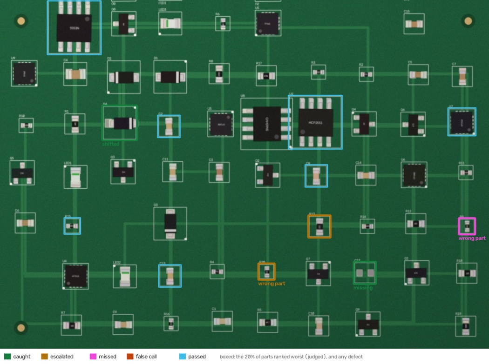

# pcb-factory-agents

**AI agents for an electronics factory, and the engineering that decides when they may work alone.**

Three agents with real jobs in a factory that builds circuit boards on demand:

- **board inspection**: checks photos of every assembled board for missing, rotated, wrong, shifted and tombstoned parts;
- **part programming**: checks that a customer's footprint fits the part, and writes the pick-and-place machine record;
- **accounts payable**: reads supplier invoice emails and books them, and chases late purchase orders.

Around them is the platform they share: sandboxed sessions that hold no credentials, a tool gateway that
runs every business action exactly once, a Postgres work queue with leases and fencing tokens, an MCP
server, OpenTelemetry tracing with cost, and an evaluation harness whose gate fails CI when a change of
model, prompt or effort level makes any agent worse. A CP-SAT replanner for the factory floor is
evaluated against the dispatch rule it would replace.

The house rules this follows: **evals first** (blind tests against people's verdicts, shadow runs,
replays), **agents judge, code writes** (structured answers, checked against a second source by plain code
that makes every change), **classical first, model second**, and **safe by construction**.

```
 sandbox: no credentials            tool gateway: holds the credentials             systems
 ┌──────────────────────┐ token  ┌────────────────────────────────────────┐
 │ agent session        │──────▶│ token, scopes, task fence              │──▶ ERP (Idempotency-Key)
 │  judge ─▶ checks ─▶  │ HTTP / │ durable receipts: each action once     │──▶ outbox ─▶ email provider
 │  actions             │  MCP   │ shadow mode, judge cache, cost         │──▶ Claude (API key)
 └──────────────────────┘        │ OpenTelemetry spans                    │
        ▲                        └────────────────────────────────────────┘
        └── claimed from a Postgres queue (SKIP LOCKED) under a lease and a fence
```

## What the evaluations show

Every number below comes from `pfa all` ([reports/](reports)). CI recomputes all of it on each push,
with a shorter crash test (30 emails) and one simulated day of replanning, and fails if the gate does. The judges here are the free, deterministic baselines (rules and classical vision);
the same harness runs Claude as the judge (see [Claude as the judge](#claude-as-the-judge)).

| Agent | Tested on | Result |
|---|---|---|
| Accounts payable | 240 emails replayed against the clerk's decisions | **0 wrong actions**, 90% of the emails a person did not need to see closed automatically |
| | The same replay, judge wrong 20% of the time (3 seeds, ~130 corrupted answers) | **0 wrong actions**: the checks caught every corruption |
| | Sessions killed at random, a worker vanishing, an ERP that loses answers | every invoice booked **exactly once**, every chase email sent once |
| Board inspection | 60 boards of 4 designs never seen in training, 151 defects | **94% of defects in the worst-ranked 20% of parts**; 81% caught automatically and 9% more escalated, 0.17 false calls per board |
| | DeepPCB: 500 real PCB image pairs, 3,140 defects, misregistered | after alignment **98% of defects found** while flagging **4% of the image** (75% without alignment) |
| Part programming | 9,267 real parts from the KiCad libraries, 1,029 designs with an injected wrong footprint | **1,028 of 1,029 wrong footprints caught**; 36% of correct designs programmed without a person |
| Factory replanning | 3 simulated days, 70 orders each, breakdowns and rush orders | CP-SAT (1 s per replan) **ties** the ATCS dispatch rule: weighted tardiness 4,089 vs 4,105. The rule stays. |

## Accounts payable: agents judge, code writes

[`backoffice/`](src/pfa/backoffice) · a month of supplier email in five house styles (plain-text table,
German number formats, CSV attachment, HTML table, prose), with price changes, over-billing, wrong
totals, wrong currencies, unknown and other suppliers' POs, credit notes, re-sent duplicates, forwarded
threads with an older invoice quoted underneath, and order confirmations that look like invoices.

The judge returns a structured answer ([schema](src/pfa/backoffice/schemas.py), [skill](src/pfa/skills/book-invoice.md)).
[Plain code](src/pfa/backoffice/checks.py) then checks it against second sources the judge never saw:

- the **sender** must be a known supplier (for forwarded mail, the forwarded header's sender);
- the **invoice number, part numbers and every amount must be printed in the email**, outside quoted history;
- the **PO** must exist and belong to that supplier, in the same **currency**;
- every line at the **PO price** (±0.5%), never more than **received minus already invoiced**;
- **lines + shipping + tax = total**;
- the **ledger**: a number already booked is a duplicate (same content) or a reuse (different content).

Only a fully reconciled invoice is booked; everything else goes to a person with the reason.

What the tests found and what changed because of them:

- With a judge corrupted 20% of the time, a unit price wrong by 0.4% passed the 0.5% tolerance and the
  2-cent total check. Every amount must now appear in the email itself.
- In the crash test, a re-sent invoice processed in parallel with its original was sent to review
  as over-billed: one session read the ledger before the other booked, and the invoiced quantity after.
  The two reads now happen in the order that makes the race harmless.
- Two invoices that each bill a PO's full delivery both pass the agent's quantity check if decided at
  the same moment. The booking action re-checks under a per-PO lock at the moment of writing:
  the race test books exactly one.

The rule-based reader closes 90% of what it could; the misses are the prose invoices its regular
expressions cannot read, which go to a person rather than being guessed.

## Board inspection: classical first, model second

[`inspect/`](src/pfa/inspect) · boards are generated from placement files (centroid, rotation, package,
marking) and photographed through a camera model (misregistration up to 2°, uneven light, blur,
noise, JPEG). Good boards also differ harmlessly: parts sit slightly off-centre, solder varies, and a
resistor placed 180° round is fine even though its printed code reads upside down.

1. **Align** the photo to the golden board (ECC, coarse to fine): 0.16 px mean error.
2. **Rank** every part with a logistic model over seven interpretable measurements (correlation with the
   golden part and with the bare pads, body marking and colour, best rotation, shift), each a z-score
   against what good parts of that package look like.
3. **Judge** the worst 20%. The classical judge decides when the measurements are clear and escalates
   when they are not; the escalations are what a vision model (or an operator) looks at.
4. **Reconcile**: a model's verdict is checked against the measurements (a part "missing" that is
   measured on its pads, a rotation that does not match) and disagreements go to an operator.



| On 60 unseen boards (151 defects) | |
|---|---|
| Defects in the worst-ranked 20% of parts | 94% (92% in the worst 10%) |
| Caught automatically / escalated / missed | 122 / 13 / 16 |
| False calls per board (60 parts) | 0.17 |
| Escalations per board | 2.0 |
| Recall by defect | missing 100%, shifted 100%, tombstone 100%, rotated 83%, **wrong part 67%** |
| Claude Sonnet 5.5 on the escalations only, estimated | ≈ $0.006 per board (vs ≈ $0.035 for all 12 ranked parts) |

Wrong parts are the hard class: a different printed code on an 0402 resistor is a few pixels. That is
exactly where reading the marking needs a model, and the ranking keeps those calls to two per board.
The cost estimate uses Anthropic's list price and image-token formula; it has not been measured.

**Real images.** [DeepPCB](https://github.com/tangsanli5201/DeepPCB) holds 1,500 real PCB template/test
pairs with boxed defects. The published pairs come pre-registered, so each test image is first put through
the camera model, then aligned. Alignment shrinks the area to examine from 75% of the image to 4.4% while
finding 97.8% of defects, and the sign of the difference tells missing copper (open, mousebite, pin hole)
from extra copper (short, spur, spurious copper) 97.8% of the time with no model. Precision is 44%:
residual edge differences remain, which is what the second stage is for.

## Part programming: a second source for every claim

[`parts/`](src/pfa/parts) · 9,833 real parts and 1,902 package footprints from the KiCad libraries (fetched
at a pinned commit). Each symbol that names a footprint is a customer design.

- **Pins = pads**: the schematic symbol's pin numbers must equal the footprint's pad numbers. On the
  unmodified libraries this flags **566 entries** where they differ (for example a 31-pin symbol on a
  27-pad footprint).
- **The footprint must fit the package the judge read** (family with its aliases, pins, body size, pitch).
- **If several land patterns fit what is known, nobody guesses**: an SOIC-8 comes 3.9 mm and 5.3 mm
  wide and both pass a pin check. Without a body size and pitch from the datasheet, it goes to a person.

That last rule is why automation is 36% with a rule-based judge that only sees one-line descriptions,
and why 170 of 170 subtle swaps (same family and pins, another size) are caught. The one miss is a
TO-252-2 swapped for a TO-252-3 with the same three pad numbers. Reading body sizes from datasheets is
the job for a model, and the gate will show whether it raises automation without letting errors through.

## Safe by construction

- **No credentials in the sandbox.** A [session](src/pfa/sandbox.py) is a separate process with a scrubbed
  environment, its own home directory and CPU and memory limits. It holds a gateway URL and an HMAC-signed
  [token](src/pfa/gateway/tokens.py) naming its task, fence, allowed tools and expiry. The gateway holds
  the ERP key and the model key. A test runs a probe session and checks its environment.
- **Every action once.** [Receipts](src/pfa/receipts.py) in Postgres, keyed by the business object
  (`supplier:invoice_number`, `chase:PO:week`), never by the session. The key doubles as the ERP's
  Idempotency-Key; email goes through a transactional outbox the provider de-duplicates. Concurrent
  calls with one key act once; the same key with different arguments is refused.
- **Fencing.** The [queue](src/pfa/workqueue.py) claims with `FOR UPDATE SKIP LOCKED` under a lease, and
  every claim bumps a fence. A worker that froze past its lease wakes up to `409 StaleSession`: in the
  test it was asleep while another worker finished its task.
- **Crash test.** 60 emails and the day's chases through 4 workers, with sessions SIGKILLed at random
  moments and at injected crash points, one worker vanishing mid-task, and an ERP that fails before
  acting 10% of the time and after acting (losing the answer) another 10%. Every invoice booked once,
  every review and chase created once, against a run where nothing failed.
- **Shadow mode.** A shadow token records what the agent would have done and does nothing: over a new
  month beside the clerk, 107 of 120 decisions agreed, 13 were needless reviews, 0 wrong, and the ERP saw
  no agent writes.
- **MCP.** [`mcp_server.py`](src/pfa/gateway/mcp_server.py) exposes a session's tools over MCP; it only
  lists the tools in the token's scope, and actions require the key.
- **Tracing.** Every judge and tool call is an OpenTelemetry span with cost, tokens, cache hits and whether
  a receipt was replayed (the crash test counts replays from the spans).

## Factory replanning

[`schedule/`](src/pfa/schedule/replan.py) · paste print, placement on one of three robots (20-minute
feeder changeover between designs), reflow, inspection by two operators; orders arriving all day,
robot breakdowns that restart the job on the robot, rush orders. CP-SAT models each robot as a circuit
with changeovers, re-solves on every arrival, breakdown and repair (about 75 times a day), is
warm-started from the dispatch rule's own schedule and adopts its plan only if it is better.

With a 1-second budget on 2 vCPUs it improved 88% of plans, by 1% on average, and over three days the
realised result is a tie: weighted tardiness 4,089 vs 4,105, on time 78.6% vs 79.0%, 147 vs 152
changeovers. On this problem ATCS is already near the best plan for the orders known at the time, and
what decides a day is the orders that have not arrived yet. The evaluation says to keep the rule.

## Claude as the judge

`ClaudeJudge` sends the skill (plain Markdown in [skills/](src/pfa/skills)) as the system prompt, images
first, with structured outputs (`output_config.format`) and an `effort` level; it checks the stop reason,
validates with pydantic and retries once with the error. The configuration hash covers model, effort, skill
text and schema, so the gate sees any change. `pfa claude` replays the back office with it and records
every answer to a cassette for free, exact re-runs; in CI it runs on demand when an `ANTHROPIC_API_KEY`
secret is configured. **No Claude numbers are reported here yet**: the build environment had no API key,
so every result above is for the rule and classical baselines.

## Run it

```bash
pip install -e ".[dev,llm,mcp]"
export PFA_DATABASE_URL=postgresql://postgres@localhost:5432/pfa   # any PostgreSQL 14+
pfa all            # 5-15 min: every evaluation, then the gate
pfa claude         # with ANTHROPIC_API_KEY: the back-office replay with Claude
PFA_TEST_DATABASE_URL=postgresql://postgres@localhost:5432/pfa_test pytest -q
```

## Layout

```
src/pfa/
  judges.py           Claude, rule, recording, replay and fault-injection judges; prices; image tokens
  gateway/            core (scopes, fences, receipts, shadow, judge cache), HTTP app, client, MCP server, tokens
  receipts.py         exactly-once actions
  workqueue.py        leases and fencing tokens on PostgreSQL
  sandbox.py          sandboxed sessions and the worker that runs them
  evals.py            outcomes, summaries, the gate
  telemetry.py        OpenTelemetry
  backoffice/         data, rule reader, checks, tools, agent, external systems, evaluation
  inspect/            board generator, alignment and ranking, judges, DeepPCB, evaluation
  parts/              KiCad reader, package checks, machine record, evaluation
  schedule/           CP-SAT replanner, dispatch rule, simulation
  skills/             what each judge is told, in plain Markdown
evals/baselines/      the numbers the gate holds every change to
reports/              generated results and figures
tests/                52 tests, including PostgreSQL, sandbox, MCP and crash tests
```

## Limits

- The boards are generated, not photographed. The real-image test (DeepPCB) covers bare boards, not
  assembled ones, and its pairs were registered by their authors before the camera model was applied.
- The factory and its suppliers are simulated; the part numbers and the KiCad libraries are real.
- The sandbox is a local process with limits. It has no network isolation; production would use a
  cloud sandbox (for example Modal) under the same token contract.
- Datasets are fetched at run time and not redistributed: DeepPCB is for research use; the KiCad
  libraries are CC-BY-SA 4.0.
